# Miscelánea III — Administración de Bases de Datos (Centro Deportivo Dubz)

> **Entorno verificado en vivo**: PostgreSQL 16 (`postgres:16`) en la red Docker `gabo-dubz`.
> - Base de datos principal definida en `.env`: `POSTGRES_DB=centro_deportivo` (también espejada como `centro_deportivo_db` para compatibilidad con ejecuciones manuales).
> - Script definitivo de la Sección 2.2: [`database/05_optimizacion_miscelanea.sql`](file:///c:/Users/gabos/Proyecto_X/database/05_optimizacion_miscelanea.sql) (reemplaza como definitivo a `03_datos_masivos.sql`, que fue eliminado para evitar duplicar la carga masiva de 100,000 filas en `/docker-entrypoint-initdb.d`).
> - Evidencias crudas de ejecución guardadas en [`docs/evidencias/05_corrida_inicial.txt`](file:///c:/Users/gabos/Proyecto_X/docs/evidencias/05_corrida_inicial.txt) y [`docs/evidencias/05_salida_final.txt`](file:///c:/Users/gabos/Proyecto_X/docs/evidencias/05_salida_final.txt).

---

## Sección 2. Optimización de Consultas y Diseño (3.0 puntos)

### 2.1 Teoría de Optimización (1.0 punto)

| Técnica | Problema que resuelve | Costo / Riesgo técnico | Cómo se complementa con las demás |
| :--- | :--- | :--- | :--- |
| **1. Índices (B-tree, compuestos, parciales, cubrientes)** | Evita recorridos secuenciales completos (`Seq Scan`) sobre tablas de alta cardinalidad, reduciendo la complejidad de búsqueda de $O(N)$ bloques a $O(\log_B N + k)$ accesos y entregando tuplas preordenadas cuando el orden del índice coincide con `ORDER BY`. | **Sobrecosto en escrituras y almacenamiento**: cada `INSERT`, `UPDATE` (no-HOT) y `DELETE` debe mantener los árboles B-tree adicionales, incrementando páginas sucias (*dirtied buffers*), generación de WAL y riesgo de división de páginas (*page splits*). | Solo es aprovechado por el optimizador si la consulta está **reescrita con predicados SARGables** y el **plan de ejecución** confirma que la selectividad justifica su uso frente a un `Seq Scan`. |
| **2. Reescritura de consultas (SARGabilidad, proyección explícita, eliminación de subconsultas correlacionadas)** | Elimina barreras algebraicas que impiden al optimizador usar índices (funciones sobre columnas como `EXTRACT(YEAR FROM fecha)` o `UPPER(col)`), reduce el ancho de tupla (`width`) evitando `SELECT *` y sustituye subconsultas escalares repetitivas (`SubPlan` ejecutado $N$ veces) por `JOIN` relacionales. | Riesgo de alterar la semántica si no se cuidan tipos de datos, zonas horarias (`TIMESTAMP` vs `TIMESTAMPTZ`), valores `NULL` o cardinalidad de los `JOIN`. | Habilita directamente el uso de **índices** (al transformar predicados en rangos continuos sobre las llaves del B-tree) y simplifica el árbol que evalúa el **plan de ejecución** sobre un esquema **normalizado**. |
| **3. Análisis del plan de ejecución (`EXPLAIN (ANALYZE, BUFFERS)`)** | Permite diagnosticar empíricamente dónde está el cuello de botella real (nodos `Seq Scan`, `Sort` en disco, `SubPlan` en bucle, discrepancias entre filas estimadas y reales por estadísticas obsoletas o correlaciones entre columnas, y exceso de lecturas en `shared hit/read`). | `EXPLAIN ANALYZE` **ejecuta realmente la sentencia**; en sentencias DML (`INSERT`/`UPDATE`/`DELETE`) modifica datos si no se envuelve en `BEGIN ... ROLLBACK` o sobre tablas temporales, y añade instrumentación de tiempo por nodo. | Es el instrumento de verificación científica de las otras tres técnicas: mide con números reales (costo del CBO, milisegundos y buffers de 8 kB) el efecto de un **índice**, una **reescritura** o un cambio de **normalización**. |
| **4. Normalización (3FN / BCNF)** | Elimina redundancia de datos y anomalías de inserción, actualización y borrado en el núcleo OLTP (por ejemplo, separar `productos_recepcion`, `clientes` y `consumos_pendientes`, conservando únicamente `precio_unitario_congelado` como atributo histórico del hecho transaccional). | Incrementa el número de tablas y requiere `JOIN` al consultar; en reportes analíticos masivos (OLAP) el exceso de `JOIN` penaliza la latencia, por lo que las cargas analíticas deben desacoplarse hacia modelos dimensionales/columnares (Data Lakehouse). | Mantiene tablas OLTP angostas (menor `width` y menos páginas de 8 kB en `consumos_pendientes`), haciendo más compactos los **índices**, más rápidos los `JOIN` tras la **reescritura** y más precisas las cardinalidades en el **plan de ejecución**. |

---

### 2.2 Caso Práctico de Optimización en Vivo: `consumos_pendientes` (2.0 puntos)

#### 0. Verificación de supuestos contra el esquema y datos reales + diagnóstico de hallazgos

Antes de dar por válido [`database/05_optimizacion_miscelanea.sql`](file:///c:/Users/gabos/Proyecto_X/database/05_optimizacion_miscelanea.sql), se auditaron todos sus supuestos directamente contra el catálogo de PostgreSQL (`pg_trigger`, `information_schema.columns`, `pg_constraint` y tablas pobladas por `01_schema_centro_deportivo.sql` y `02_seed_datos.sql`):

1. **Trigger de inventario**: confirmado `trg_antes_insertar_consumo` (`BEFORE INSERT ON consumos_pendientes FOR EACH ROW EXECUTE FUNCTION fn_registrar_consumo_recepcion()`, `tgenabled = 'O'`). Deshabilitarlo temporalmente con `ALTER TABLE consumos_pendientes DISABLE TRIGGER trg_antes_insertar_consumo;` durante la inserción sintética de 100,000 filas evita agotar `stock_actual` y se rehabilita inmediatamente después.
2. **Columnas verificadas**:
   - `consumos_pendientes`: `id_consumo`, `id_cliente`, `id_producto`, `cantidad`, `precio_unitario_congelado`, `subtotal` (`GENERATED ALWAYS AS (cantidad * precio_unitario_congelado) STORED`), `estado_pago`, `fecha_consumo` (`timestamp without time zone`), `fecha_pago`.
   - `clientes`: `id_cliente`, `nombre`, `apellido` (4 filas semilla).
   - `productos_recepcion`: `id_producto`, `nombre`, `precio_unitario` (5 filas semilla, con restricción `UNIQUE (nombre)` denominada `productos_recepcion_nombre_key`).
3. **Producto objetivo en datos semilla**: confirmado `'Electrolitos Sabor Mora 625ml'` con `id_producto = 2` y nombre único en `productos_recepcion`.
4. **Reconciliación con `03_datos_masivos.sql`**: se eliminó `database/03_datos_masivos.sql` y quedó [`database/05_optimizacion_miscelanea.sql`](file:///c:/Users/gabos/Proyecto_X/database/05_optimizacion_miscelanea.sql) como script único y definitivo de carga masiva (100,000 filas, idempotente con guarda `IF v_total < 50000`) y pruebas de optimización de la Sección 2.2.
5. **Hallazgos corregidos tras la primera ejecución en vivo ([`docs/evidencias/05_corrida_inicial.txt`](file:///c:/Users/gabos/Proyecto_X/docs/evidencias/05_corrida_inicial.txt))**:
   - **Correlación modular $\gcd(10, 5) = 5$ en el generador sintético**: el script original asignaba `estado_pago = 'PENDIENTE'` cuando `(g % 10) = 0` y elegía el producto con `OFFSET (g % 5) LIMIT 1` (pues `COUNT(*) FROM productos_recepcion = 5`). Como $\gcd(10, 5) = 5$, toda fila con $g \equiv 0 \pmod{10}$ cumplía forzosamente $g \equiv 0 \pmod 5$ (`OFFSET 0`), concentrando las **10,000 filas sintéticas `PENDIENTE` en un solo producto** y dejando a `'Electrolitos Sabor Mora 625ml'` con **0 filas sintéticas `PENDIENTE`** (solo 1 fila del seed). Se corrigió desacoplando los índices mediante cocientes enteros ortogonales (`g % v_n_prods`, `(g / v_n_prods) % v_n_clientes` y `(g / (v_n_prods * v_n_clientes)) % 10`) y fijando `PERFORM setseed(0.42)`, logrando una distribución uniforme exacta: **2,000 filas `PENDIENTE` por cada uno de los 5 productos** (128 filas en el mes actual para `'Electrolitos Sabor Mora 625ml'`).
   - **Demostración explícita del `Seq Scan` en la consulta lenta (a)**: dado que `01_schema_centro_deportivo.sql` incluye `idx_consumos_cliente_estado (id_cliente, estado_pago)`, al usar `UPPER(cp.estado_pago) = 'PENDIENTE'` junto con `EXTRACT(YEAR ...)` y `EXTRACT(MONTH ...)` en la consulta lenta se exhibe de forma pura el antipatrón de funciones no SARGables sobre columnas filtradas, forzando el `Parallel Seq Scan on consumos_pendientes cp`.
   - **Alineación de tipos `TIMESTAMP WITHOUT TIME ZONE`**: en la consulta optimizada (d), `date_trunc('month', CURRENT_DATE)` convertía implícitamente `CURRENT_DATE` a ` timestamp with time zone`. Se ajustó a `date_trunc('month', CURRENT_DATE::TIMESTAMP)` para comparar `timestamp without time zone` contra `timestamp without time zone` con funciones `IMMUTABLE`.

##### Distribución real de `consumos_pendientes` (100,004 filas; 8,248 kB en 1,031 páginas de 8 kB)

```text
 estado_pago | filas 
-------------+-------
 PAGADO      | 85000
 PENDIENTE   | 10004
 CONDONADO   |  5000
(3 rows)
```

---

#### (a) Consulta Lenta y Plan de Ejecución Real (`Seq Scan`)

```sql
EXPLAIN (ANALYZE, BUFFERS)
SELECT *,
       (SELECT p.nombre
        FROM productos_recepcion p
        WHERE p.id_producto = cp.id_producto) AS nombre_producto
FROM consumos_pendientes cp
JOIN clientes c ON c.id_cliente = cp.id_cliente
WHERE UPPER(cp.estado_pago) = 'PENDIENTE'
  AND cp.id_producto = (
      SELECT p2.id_producto
      FROM productos_recepcion p2
      WHERE p2.nombre = 'Electrolitos Sabor Mora 625ml'
  )
  AND EXTRACT(YEAR  FROM cp.fecha_consumo) = EXTRACT(YEAR  FROM CURRENT_DATE)
  AND EXTRACT(MONTH FROM cp.fecha_consumo) = EXTRACT(MONTH FROM CURRENT_DATE)
ORDER BY cp.fecha_consumo DESC;
```

##### Salida real de `EXPLAIN (ANALYZE, BUFFERS)` — Plan (a)

```text
 Sort  (cost=4240.30..4240.30 rows=1 width=275) (actual time=8.005..9.438 rows=128 loops=1)
   Sort Key: cp.fecha_consumo DESC
   Sort Method: quicksort  Memory: 45kB
   Buffers: shared hit=1288
   InitPlan 2 (returns $1)
     ->  Seq Scan on productos_recepcion p2  (cost=0.00..1.06 rows=1 width=4) (actual time=0.007..0.007 rows=1 loops=1)
           Filter: ((nombre)::text = 'Electrolitos Sabor Mora 625ml'::text)
           Rows Removed by Filter: 4
           Buffers: shared hit=1
   ->  Nested Loop  (cost=1000.00..4239.22 rows=1 width=275) (actual time=0.704..9.357 rows=128 loops=1)
         Join Filter: (cp.id_cliente = c.id_cliente)
         Rows Removed by Join Filter: 198
         Buffers: shared hit=1288
         ->  Gather  (cost=1000.00..4237.07 rows=1 width=49) (actual time=0.722..9.010 rows=128 loops=1)
               Workers Planned: 1
               Params Evaluated: $1
               Workers Launched: 1
               Buffers: shared hit=1032
               ->  Parallel Seq Scan on consumos_pendientes cp  (cost=0.00..3236.97 rows=1 width=49) (actual time=0.095..5.123 rows=64 loops=2)
                     Filter: ((id_producto = $1) AND (upper((estado_pago)::text) = 'PENDIENTE'::text) AND (EXTRACT(year FROM fecha_consumo) = EXTRACT(year FROM CURRENT_DATE)) AND (EXTRACT(month FROM fecha_consumo) = EXTRACT(month FROM CURRENT_DATE)))
                     Rows Removed by Filter: 49938
                     Buffers: shared hit=1031
         ->  Seq Scan on clientes c  (cost=0.00..1.04 rows=4 width=48) (actual time=0.000..0.000 rows=3 loops=128)
               Buffers: shared hit=128
         SubPlan 1
           ->  Seq Scan on productos_recepcion p  (cost=0.00..1.06 rows=1 width=26) (actual time=0.001..0.001 rows=1 loops=128)
                 Filter: (id_producto = cp.id_producto)
                 Rows Removed by Filter: 4
                 Buffers: shared hit=128
 Planning:
   Buffers: shared hit=126
 Planning Time: 0.403 ms
 Execution Time: 9.475 ms
```

##### Identificación del cuello de botella en el Plan (a)

1. **`Parallel Seq Scan on consumos_pendientes cp`**: al aplicar funciones sobre las columnas filtradas (`UPPER(cp.estado_pago)` y `EXTRACT(YEAR/MONTH FROM cp.fecha_consumo)`), los predicados no son SARGables (*Search Argument Able*). El motor lee las **1,031 páginas completas de la tabla** (`Buffers: shared hit=1031`, equivalentes a `8,248 kB`) y evalúa las 4 condiciones fila por fila sobre las 100,004 tuplas, descartando `49,938 × 2 = 99,876` filas (`Rows Removed by Filter: 49938` en `loops=2`) para conservar solo 128.
2. **Error de estimación de cardinalidad (`rows=1` estimado vs `rows=128` reales)**: al no tener estadísticas sobre las expresiones `UPPER(...)` y `EXTRACT(...)`, el optimizador subestima drásticamente el resultado (`rows=1`), lo que lo lleva a elegir un `Nested Loop` sin índice contra `clientes` (`Seq Scan on clientes c` ejecutado **128 veces**, `loops=128`, 128 buffers adicionales).
3. **Subconsulta escalar correlacionada en el `SELECT` (`SubPlan 1`)**: ejecuta un `Seq Scan on productos_recepcion p` por cada una de las 128 filas resultantes (`loops=128`, otros 128 buffers).
4. **Exceso de ancho de tupla (`SELECT *`, `width=275` bytes)**: arrastra todas las columnas de `consumos_pendientes` y `clientes` hacia el nodo `Sort` (`Memory: 45kB`).

---

#### (b) Creación y Justificación del Índice Compuesto Parcial

```sql
CREATE INDEX idx_consumos_pendientes_prod_fecha
    ON consumos_pendientes (id_producto, fecha_consumo DESC)
    WHERE estado_pago = 'PENDIENTE';

ANALYZE consumos_pendientes;
```

##### Justificación técnica del diseño del índice

1. **Por qué es un índice PARCIAL (`WHERE estado_pago = 'PENDIENTE'`)**:
   - Las consultas operativas de cobranza y adeudos en recepción solo buscan consumos con `estado_pago = 'PENDIENTE'`, que representan únicamente **10,004 de las 100,004 filas (10.0%)**; el 90% restante (`PAGADO` = 85,000 y `CONDONADO` = 5,000) es histórico inactivo para cobranza.
   - Al excluir ese 90% del árbol B-tree, el índice ocupa apenas **`328 kB`** frente a **`8,248 kB`** de la tabla (**3.98% del tamaño de la tabla**) y frente a **`4,288 kB`** que ocuparía el mismo índice compuesto sin la cláusula `WHERE` (**reducción de 92.3% en tamaño de índice**).
2. **Justificación del orden de las columnas `(id_producto, fecha_consumo DESC)`**:
   - **Regla igualdad → rango/ordenamiento en árboles B-tree**: la primera columna debe ser **`id_producto`** porque la consulta filtra por **igualdad** (`cp.id_producto = p.id_producto` para `'Electrolitos Sabor Mora 625ml'`). Esto restringe la búsqueda inmediatamente a la sub-rama del producto 2 (~2,000 entradas dentro de las 10,004 del índice parcial).
   - La segunda columna es **`fecha_consumo DESC`** porque sobre ella se aplica un **predicado de rango** (`fecha_consumo >= ... AND fecha_consumo < ...`) y además un **`ORDER BY cp.fecha_consumo DESC`**. Dentro de la partición lógica de `id_producto = 2`, las hojas del B-tree quedan contiguas y ordenadas de forma descendente por fecha, permitiendo acotar el rango mensual en solo **3 páginas de índice** (`Buffers: shared read=3`). Si el orden se invirtiera a `(fecha_consumo DESC, id_producto)`, el motor tendría que recorrer todos los productos del mes antes de filtrar `id_producto = 2`.

---

#### (c) y (d) Consulta Reescrita y Nuevo Plan de Ejecución Real

```sql
EXPLAIN (ANALYZE, BUFFERS)
SELECT
    cp.id_consumo,
    c.nombre || ' ' || c.apellido AS cliente,
    p.nombre AS producto,
    cp.cantidad,
    cp.subtotal,
    cp.fecha_consumo
FROM consumos_pendientes cp
JOIN clientes c ON c.id_cliente = cp.id_cliente
JOIN productos_recepcion p ON p.id_producto = cp.id_producto
WHERE cp.estado_pago = 'PENDIENTE'
  AND p.nombre = 'Electrolitos Sabor Mora 625ml'
  AND cp.fecha_consumo >= date_trunc('month', CURRENT_DATE::TIMESTAMP)
  AND cp.fecha_consumo <  date_trunc('month', CURRENT_DATE::TIMESTAMP) + INTERVAL '1 month'
ORDER BY cp.fecha_consumo DESC;
```

##### Salida real de `EXPLAIN (ANALYZE, BUFFERS)` — Plan (d)

```text
 Sort  (cost=355.22..355.52 rows=117 width=79) (actual time=0.233..0.238 rows=128 loops=1)
   Sort Key: cp.fecha_consumo DESC
   Sort Method: quicksort  Memory: 37kB
   Buffers: shared hit=118 read=3
   ->  Nested Loop  (cost=5.93..351.21 rows=117 width=79) (actual time=0.042..0.207 rows=128 loops=1)
         Buffers: shared hit=118 read=3
         ->  Nested Loop  (cost=5.79..347.15 rows=117 width=51) (actual time=0.036..0.165 rows=128 loops=1)
               Buffers: shared hit=110 read=3
               ->  Seq Scan on productos_recepcion p  (cost=0.00..1.06 rows=1 width=30) (actual time=0.003..0.004 rows=1 loops=1)
                     Filter: ((nombre)::text = 'Electrolitos Sabor Mora 625ml'::text)
                     Rows Removed by Filter: 4
                     Buffers: shared hit=1
               ->  Bitmap Heap Scan on consumos_pendientes cp  (cost=5.79..344.92 rows=117 width=29) (actual time=0.031..0.148 rows=128 loops=1)
                     Recheck Cond: ((p.id_producto = id_producto) AND (fecha_consumo >= date_trunc('month'::text, (CURRENT_DATE)::timestamp without time zone)) AND (fecha_consumo < (date_trunc('month'::text, (CURRENT_DATE)::timestamp without time zone) + '1 mon'::interval)) AND ((estado_pago)::text = 'PENDIENTE'::text))
                     Heap Blocks: exact=109
                     Buffers: shared hit=109 read=3
                     ->  Bitmap Index Scan on idx_consumos_pendientes_prod_fecha  (cost=0.00..5.77 rows=117 width=0) (actual time=0.019..0.019 rows=128 loops=1)
                           Index Cond: ((id_producto = p.id_producto) AND (fecha_consumo >= date_trunc('month'::text, (CURRENT_DATE)::timestamp without time zone)) AND (fecha_consumo < (date_trunc('month'::text, (CURRENT_DATE)::timestamp without time zone) + '1 mon'::interval)))
                           Buffers: shared read=3
         ->  Memoize  (cost=0.14..0.18 rows=1 width=17) (actual time=0.000..0.000 rows=1 loops=128)
               Cache Key: cp.id_cliente
               Cache Mode: logical
               Hits: 124  Misses: 4  Evictions: 0  Overflows: 0  Memory Usage: 1kB
               Buffers: shared hit=8
               ->  Index Scan using clientes_pkey on clientes c  (cost=0.13..0.17 rows=1 width=17) (actual time=0.001..0.001 rows=1 loops=4)
                     Index Cond: (id_cliente = cp.id_cliente)
                     Buffers: shared hit=8
 Planning:
   Buffers: shared hit=42 read=1
 Planning Time: 0.366 ms
 Execution Time: 0.265 ms
```

##### Comparación cuantitativa Antes vs. Después (números reales del contenedor)

| Métrica | Antes — Plan (a) Lento | Después — Plan (d) Optimizado | Mejora real |
| :--- | :---: | :---: | :---: |
| **Operador de acceso a `consumos_pendientes`** | `Parallel Seq Scan` (lee toda la tabla) | `Bitmap Index Scan` sobre `idx_consumos_pendientes_prod_fecha` | Elimina recorrido completo |
| **Costo estimado del plan (CBO)** | `4,240.30` | `355.52` | **-91.6% de costo (`11.9x` menor)** |
| **Tiempo de ejecución (`Execution Time`)** | **`9.475 ms`** (`12.915 ms` en 1.ª corrida) | **`0.265 ms`** (`0.332 ms` en 1.ª corrida) | **-97.2% de tiempo (`35.8x` más rápida)** |
| **Tiempo de planeación (`Planning Time`)** | `0.403 ms` | `0.366 ms` | **-9.2%** |
| **Bloques de 8 kB tocados (`Buffers`)** | `1,288` (`1,031` de tabla + `257` de bucles) | `121` (`3` de índice + `109` de tabla + `9` de catálogos) | **-90.6% de bloques I/O (`10.6x` menos)** |
| **Filas descartadas tras leer el heap (`Rows Removed by Filter`)** | `99,876` (`49,938 × 2` workers) | **`0`** (las 128 tuplas vienen filtradas por el índice) | **100% de precisión en el índice** |
| **Estimación vs. realidad de filas** | Estimó `1`, devolvió `128` (error `128x`) | Estimó `117`, devolvió `128` (precisión del **91.4%**) | Estadísticas aprovechadas por predicado SARGable |
| **Ancho de tupla (`width`) en el `Sort`** | `275 bytes` (`Memory: 45kB`) | `79 bytes` (`Memory: 37kB`) | **-71.3% de ancho por fila** |

---

#### (e) Costo del Índice sobre las Escrituras (Evidencia Experimental y Análisis DBA)

Para cuantificar el impacto real en escrituras sin contaminar la tabla operativa, la sección `(e)` de [`database/05_optimizacion_miscelanea.sql`](file:///c:/Users/gabos/Proyecto_X/database/05_optimizacion_miscelanea.sql) ejecuta un `INSERT` masivo de las **100,004 filas** en tres tablas temporales con idéntica estructura (`LIKE consumos_pendientes INCLUDING DEFAULTS INCLUDING GENERATED`) tras precalentar el buffer pool:

1. **`(e.1)` Sin índice secundario**:
   ```text
   Insert on tmp_consumos_sin_idx  (cost=0.00..2031.04 rows=0 width=0) (actual time=72.824..72.826 rows=0 loops=1)
     Buffers: shared hit=1031, local hit=102062 dirtied=1031 written=1043
   Execution Time: 72.873 ms
   ```
2. **`(e.2)` Con nuestro índice PARCIAL compuesto `(id_producto, fecha_consumo DESC) WHERE estado_pago = 'PENDIENTE'`**:
   ```text
   Insert on tmp_consumos_con_idx_parcial  (cost=0.00..2031.04 rows=0 width=0) (actual time=81.517..81.518 rows=0 loops=1)
     Buffers: shared hit=1047, local hit=121870 read=4 dirtied=1084 written=2167
   Execution Time: 81.537 ms
   ```
3. **`(e.3)` Con un índice compuesto COMPLETO `(id_producto, fecha_consumo DESC)` sin cláusula `WHERE`**:
   ```text
   Insert on tmp_consumos_con_idx_total  (cost=0.00..2031.04 rows=0 width=0) (actual time=163.884..163.885 rows=0 loops=1)
     Buffers: shared hit=1047, local hit=344233 read=4 dirtied=1570 written=3139
   Execution Time: 163.906 ms
   ```

| Escenario de escritura (`INSERT` de 100,004 filas) | Tiempo de ejecución | Sobrecosto en tiempo | Accesos a buffers (`local hit`) | Páginas ensuciadas (`dirtied`) | Tamaño del índice |
| :--- | :---: | :---: | :---: | :---: | :---: |
| **(e.1) Sin índice secundario** | `72.873 ms` | Base (`0.0%`) | `102,062` | `1,031` | `0 kB` |
| **(e.2) Con índice PARCIAL (`WHERE estado_pago = 'PENDIENTE'`)** | **`81.537 ms`** | **`+8.664 ms` (`+11.9%`)** | `121,870` (`+19,808`) | `1,084` (`+53` págs.) | **`328 kB`** (`400 kB` incr.) |
| **(e.3) Con índice COMPLETO (sin `WHERE`)** | `163.906 ms` | `+91.033 ms` (`+124.9%`) | `344,233` (`+242,171`) | `1,570` (`+539` págs.) | `4,288 kB` |

##### Explicación técnica del costo en escrituras (`INSERT`, `UPDATE`, `DELETE`)

- **En cada `INSERT`**: PostgreSQL evalúa primero el predicado parcial `estado_pago = 'PENDIENTE'`. Si la fila entra como `'PAGADO'` o `'CONDONADO'` (90% del volumen histórico), **no toca el árbol B-tree**, ahorrando **90.5% del sobrecosto de inserción** (`+8.66 ms` frente a `+91.03 ms` del índice completo) y **222,363 operaciones de buffer**. Cuando la fila sí es `'PENDIENTE'`, el motor desciende por el B-tree de `idx_consumos_pendientes_prod_fecha`, inserta el puntero `(ctid)` en la página hoja correspondiente, ensucia la página (`dirtied`) y escribe el registro en el WAL (*Write-Ahead Log*).
- **En cada `UPDATE`**:
  - Si cambia `cantidad` o `fecha_pago` pero **no** cambian `id_producto`, `fecha_consumo` ni `estado_pago`, y existe espacio en la misma página de 8 kB, PostgreSQL aplica una actualización **HOT (*Heap-Only Tuple*)** sin crear una nueva entrada en el índice.
  - Cuando un cliente liquida su adeudo en recepción (`UPDATE consumos_pendientes SET estado_pago = 'PAGADO'`), la nueva versión de la tupla deja de cumplir `WHERE estado_pago = 'PENDIENTE'`: no inserta una entrada nueva en `idx_consumos_pendientes_prod_fecha`, y la entrada antigua apunta a una tupla muerta que `autovacuum` recicla, manteniendo el índice parcial permanentemente compacto (~328 kB).
- **En cada `DELETE`**: marca la tupla como muerta en el heap; la limpieza física de las entradas en el índice la realiza `VACUUM` en segundo plano.


---

## Sección 3. Migración y Escalabilidad hacia Data Lakehouse (4.0 puntos)

### 3.1 Arquitectura de Desacoplamiento OLTP → Data Lakehouse (1.0 punto)

#### Diagrama de Arquitectura (Mermaid)

```mermaid
flowchart LR
    subgraph AppLayer["Capa de Aplicaciones"]
        AppMovil["App Móvil / Web\n(Atletas y Head Coach)"]
        AppDesk["App Escritorio\n(Dueño y Recepción)"]
    end

    subgraph OLTPLayer["Capa Transaccional OLTP (PostgreSQL 16 - Red gabo-dubz)"]
        PGPrimary[("PostgreSQL Primario\n(postgres:5432)\n3FN + Triggers + ACID")]
        PGReplica[("Réplica de Lectura\n(Streaming WAL Asíncrono)\nEn local: lectura controlada\ncon reporting_user1")]
        MaskedViews[["Vistas de Seguridad PII\nvw_clientes_enmascarado\nvw_usuarios_enmascarado"]]
    end

    subgraph ETLLayer["Motor de Procesamiento Distribuido (PySpark 3.5 - pyspark:8888)"]
        Params["parameters.json\n(Sin secretos harcodeados:\nresuelve variables de .env)"]
        PySpark["5 Pipelines ETL\n(POO BaseETL + Prog. Funcional)\nJDBC fetchsize=10,000\nrol: reporting_user1 (readonly)"]
    end

    subgraph LakehouseLayer["Capa Analítica Data Lakehouse (Curated Zone)"]
        LocalParquet[("Volumen Curated Local\n/home/jovyan/data_lake/curated\nParquet + Compresión Snappy\nParticionado por negocio")]
        S3Ministack[("Object Storage S3\n(ministack:4566 + stackport:8080)\ns3a://lakehouse-centro-deportivo/\nparquet/ & iceberg/")]
        IcebergCatalog[["Catálogo Apache Iceberg\nlakehouse.centro_deportivo.*\nMetadatos ACID, Time-Travel,\nSchema & Partition Evolution"]]
    end

    subgraph AnalyticsLayer["Consumo Analítico / BI / Ciencia de Datos (Cero impacto al OLTP)"]
        Jupyter["JupyterLab / PyMC / SciPy\nModelos Estocásticos y Estadística"]
        Grafana["Reportes Ejecutivos / BI\n(Ingresos, Retención, Clientes 360)"]
    end

    AppMovil -->|"Escrituras/Lecturas cortas\n(INSERT/UPDATE indexados)"| PGPrimary
    AppDesk -->|"Cobros, Membresías,\nAuditoría condonaciones"| PGPrimary
    PGPrimary ==>|"Replicación continua\npor flujo WAL"| PGReplica
    PGReplica --> MaskedViews
    Params -.->|"Inyección de configuración"| PySpark
    MaskedViews ==>|"Extracción JDBC por lotes\n(SSL + Solo lectura + PII enmascarada)"| PySpark
    PySpark ==>|"Carga columnar particionada"| LocalParquet
    PySpark ==>|"Escritura S3A"| S3Ministack
    S3Ministack --- IcebergCatalog
    LocalParquet --> Jupyter
    IcebergCatalog --> Jupyter
    IcebergCatalog --> Grafana
```



#### Flujo de datos y justificación técnica de cada componente (cómo se libera al OLTP)

1. **PostgreSQL Primario (`postgres:5432`, OLTP en 3FN)**:
   - **Rol**: atiende exclusivamente transacciones operativas de baja latencia y alta concurrencia (registro de clientes, cobros y adeudos en recepción con bloqueo `FOR UPDATE` sobre `productos_recepcion`, publicación de entrenamientos de 60 minutos y bitácora inmutable `auditoria_consumos`).
   - **Por qué debe liberarse**: las consultas analíticas (agregaciones históricas sobre `100,004` consumos, funciones de ventana `LEAD`/`LAG` sobre membresías y marcas, o cruces de 5 tablas para la vista 360 del cliente) realizan escaneos masivos que expulsan del *buffer pool* (`shared_buffers`) las páginas calientes de operación diaria, compiten por CPU/I/O y prolongan la retención de instantáneas MVCC (`xmin`), retrasando la limpieza de tuplas muertas por `autovacuum`.
2. **Réplica de Lectura por Streaming WAL y Vistas Enmascaradas (`vw_clientes_enmascarado`, `vw_usuarios_enmascarado`)**:
   - **Rol**: en producción, el primario envía continuamente sus segmentos WAL (*Write-Ahead Log*) a una instancia *hot standby* de solo lectura; el motor ETL se conecta a esa réplica con el usuario de mínimo privilegio `reporting_user1` (`readonly`, `statement_timeout = 30s`, `CONNECTION LIMIT 5`) y lee a través de las vistas que ocultan `password_hash`, `telefono` y `email`.
   - **Análisis de viabilidad de la réplica WAL en el entorno local (`3.674 GiB` de RAM en WSL2)**:
     - Se midió en vivo con `docker stats --no-stream` el consumo de memoria de los contenedores activos en la máquina virtual Linux (`MemTotal = 3,762 MB ≈ 3.674 GiB`):
       - `neo4j`: `723.2 MiB` (`19.22%`)
       - `grafana`: `475.4 MiB` (`12.63%`)
       - `databasus`: `156.1 MiB` (`4.15%`)
       - `proyecto_x-pyspark-1`: `136.3 MiB` en reposo, escalando a **`~1.15 GiB`** al levantar la JVM del driver de Spark (`driver_memory = 1g`) durante la ejecución de los 5 ETL
       - `postgres`: `92.64 MiB` (`2.46%`)
       - `prometheus`: `79.41 MiB` (`2.11%`)
       - `proyecto_x-stackport-1`: `42.45 MiB` (`1.13%`)
       - `proyecto_x-ministack-1`: `38.55 MiB` (`1.02%`)
     - **Decisión técnica fundamentada**: la suma base (`~1.74 GiB`) más el pico de la JVM de PySpark (`~1.15 GiB`) y la caché del kernel deja menos de `700 MiB` libres en el límite de `3.674 GiB` de WSL2 (además de la restricción del proyecto de conservar exactamente los **9 servicios** del `docker-compose.yml`). Forzar un décimo contenedor `postgres-replica` con su propio *shared buffer pool* y procesos *walreceiver* aumenta el riesgo de *OOM-kill* o *thrashing* durante el `spark-submit`. Por ello, **en desarrollo local se mantiene la extracción contra `postgres` en ventana controlada con `reporting_user1`**, y el diseño queda **100% parametrizado en [`etl/parameters.json`](file:///c:/Users/gabos/Proyecto_X/etl/parameters.json)** (`"host": "${POSTGRES_HOST:-postgres}"`): para pasar a la réplica WAL en producción basta con definir `POSTGRES_HOST=postgres-replica` en `.env` (o cambiar `"host"` en `parameters.json`) **sin modificar una sola línea de código en los 5 ETL**.
3. **Motor ETL en PySpark (`pyspark:8888`, POO + Programación Funcional)**:
   - **Rol**: extrae únicamente las columnas necesarias (*column pruning*) mediante JDBC por lotes (`fetchsize = 10,000`), ejecuta en memoria distribuida de Spark los `JOIN`, agregaciones condicionales y funciones de ventana (`Window.partitionBy`), y escribe el resultado ya precalculado y desnormalizado.
4. **Almacenamiento Columnar Parquet + Catálogo Apache Iceberg sobre S3 (`ministack:4566` y `/home/jovyan/data_lake/curated`)**:
   - **Rol**: los archivos **Apache Parquet** con compresión **Snappy** almacenan los datos por columna y particionados por llaves de negocio (`categoria`, `nombre_plan`, `tipo_bloque`, `estado_membresia`), logrando *partition pruning*, *predicate pushdown* con estadísticas `min/max` por *row group* y lecturas vectorizadas. Sobre ellos, **Apache Iceberg** (`lakehouse.centro_deportivo.<tabla>`) aporta transacciones ACID en el Data Lake, aislamiento de instantáneas (*snapshot isolation*), *time-travel* y evolución de esquema/particiones sin reescribir datos.
   - **Resultado para el OLTP**: todos los tableros financieros del dueño, análisis de retención, curvas de progreso físico y modelos probabilísticos/estocásticos en Jupyter leen directamente de Parquet/Iceberg (**0 consultas analíticas sobre PostgreSQL**).


---

### 3.2 Construcción y Ejecución en Vivo de los 5 Pipelines ETL en PySpark (2.0 puntos)

#### Diseño de Ingeniería de Software (POO + Programación Funcional + Cero valores fijos)

- **Parametrización externa total ([`etl/parameters.json`](file:///c:/Users/gabos/Proyecto_X/etl/parameters.json) + [`etl/config.py`](file:///c:/Users/gabos/Proyecto_X/etl/config.py))**: ninguna ruta, credencial, host, bucket ni tabla está fija en el código Python; `config.py` resuelve expresiones `${VAR:-defecto}` contra las variables de entorno inyectadas desde `.env` al contenedor `pyspark`.
- **Programación Orientada a Objetos ([`etl/BaseETL.py`](file:///c:/Users/gabos/Proyecto_X/etl/BaseETL.py))**: clase abstracta `BaseETL(ABC)` que encapsula la construcción de la URL JDBC (`?sslmode=prefer`), la lectura por alias (`self.leer(alias)` con `fetchsize = 10,000`), la escritura dual en **Parquet particionado con compresión Snappy** (tanto en `/home/jovyan/data_lake/curated/<tabla>` como en `s3a://lakehouse-centro-deportivo/parquet/<tabla>`) y el registro en el catálogo **Apache Iceberg** (`lakehouse.centro_deportivo.<tabla>`).
- **Programación Funcional ([`etl/funciones.py`](file:///c:/Users/gabos/Proyecto_X/etl/funciones.py))**: funciones puras sin efectos secundarios (`mes_de`, `razon`, `suma_si`, `cuenta_si`, `imc`, `telefono_enmascarado`, `con_columna`) compuestas mediante `DataFrame.transform(...)`.

#### Propósito, Fuentes y Resultados Reales de los 5 ETL

| # | Script / Clase ETL | Tabla destino (Parquet + Iceberg) | Fuentes en PostgreSQL (`reporting_user1`) | Propósito analítico y transformaciones clave | Particiones generadas (`partitionBy`) | Archivos Parquet | Tamaño (bytes) | Filas escritas y leídas |
| :-: | :--- | :--- | :--- | :--- | :--- | :-: | :-: | :-: |
| **1** | [`IngresosRecepcionMensualETL.py`](file:///c:/Users/gabos/Proyecto_X/etl/IngresosRecepcionMensualETL.py) | `fact_ingresos_recepcion_mensual` | `public.consumos_pendientes` (`100,004` filas) + `public.productos_recepcion` + `public.vw_clientes_enmascarado` | Agrega por `mes × categoria` las ventas efectivamente cobradas (`PAGADO`), adeudos (`PENDIENTE`), montos `CONDONADO`, unidades, clientes activos distintos, rotación de inventario (`unidades_cobradas / stock_actual_categoria`) y `% de cobranza`. | `categoria=AGUA`, `categoria=ELECTROLITOS`, `categoria=SNACKS` | `3` | `14,340 B` | **`39`** (13 meses × 3 categorías) |
| **2** | [`RetencionMembresiasETL.py`](file:///c:/Users/gabos/Proyecto_X/etl/RetencionMembresiasETL.py) | `fact_retencion_membresias` | `public.membresias_clientes` + `public.tipos_membresia` + `public.vw_clientes_enmascarado` | Evalúa por cohorte `mes × nombre_plan` los ingresos por plan, membresías activas vs. vencidas (calculadas por fecha de corte), tasa de renovación con ventana `LEAD(fecha_inicio)` dentro de 30 días de gracia y efectividad diferencial de los recordatorios amigables. | `nombre_plan=Mensualidad Ilimitada`, `nombre_plan=Paquete 12 Clases`, `nombre_plan=Trimestral Pro` | `3` | `15,370 B` | **`3`** |
| **3** | [`ProgresoAtletasETL.py`](file:///c:/Users/gabos/Proyecto_X/etl/ProgresoAtletasETL.py) | `fact_progreso_atletas` | `public.historial_marcas_clientes` + `public.vw_clientes_enmascarado` | Resume por `id_cliente × mes` el último peso registrado (`max_by`), IMC (`peso / (altura/100)²`) y las variaciones mensuales (`LAG`) y acumuladas (`FIRST`) de peso, `max_reps_situps`, `max_reps_pushups` y `max_reps_pullups`. | *(Sin partición por cardinalidad compacta)* | `1` | `6,200 B` | **`6`** |
| **4** | [`CargaEntrenamientosCoachETL.py`](file:///c:/Users/gabos/Proyecto_X/etl/CargaEntrenamientosCoachETL.py) | `fact_entrenamientos_bloques` | `public.entrenamientos` + `public.bloques_entrenamiento` + `public.vw_usuarios_enmascarado` | Analiza por `coach × mes × tipo_bloque` la distribución real del tiempo de las sesiones de 60 min (`minutos_totales`, `minutos_promedio`, `% del tiempo del coach`) y explota con `SPLIT`/`EXPLODE` la lista `equipamiento_requerido` para identificar el equipo más utilizado. | `tipo_bloque=AIRE`, `tipo_bloque=CALENTAMIENTO`, `tipo_bloque=FUERZA`, `tipo_bloque=WOD` | `4` | `12,754 B` | **`4`** |
| **5** | [`ResumenClientes360ETL.py`](file:///c:/Users/gabos/Proyecto_X/etl/ResumenClientes360ETL.py) | `dim_clientes_360` | `public.vw_clientes_enmascarado` + `public.membresias_clientes` + `public.tipos_membresia` + `public.consumos_pendientes` + `public.historial_marcas_clientes` | Construye la dimensión ejecutiva desnormalizada (1 fila por cliente) con `telefono_enmascarado`, antigüedad en días, membresía más reciente (`ROW_NUMBER`), adeudo total pendiente en recepción, últimas marcas personales e IMC actual, evitando golpear al OLTP. | `estado_membresia=ACTIVA`, `estado_membresia=POR_VENCER`, `estado_membresia=VENCIDA` | `3` | `16,748 B` | **`4`** |

#### Salida real de ejecución de [`etl/run.py`](file:///c:/Users/gabos/Proyecto_X/etl/run.py) dentro del contenedor `proyecto_x-pyspark-1` ([`docs/evidencias/03_etl_salida.txt`](file:///c:/Users/gabos/Proyecto_X/docs/evidencias/03_etl_salida.txt))

```text
[run] bucket creado: s3://lakehouse-centro-deportivo
[OK] IngresosRecepcionMensualETL      -> fact_ingresos_recepcion_mensual filas=39      28.7s  {'ruta': '/home/jovyan/data_lake/curated/fact_ingresos_recepcion_mensual', 'archivos_parquet': 3, 'particiones': ['categoria=AGUA', 'categoria=ELECTROLITOS', 'categoria=SNACKS'], 'bytes': 14340, 'filas_leidas': 39, 'ok': True}  iceberg=lakehouse.centro_deportivo.fact_ingresos_recepcion_mensual
[OK] RetencionMembresiasETL           -> fact_retencion_membresias    filas=3        9.7s  {'ruta': '/home/jovyan/data_lake/curated/fact_retencion_membresias', 'archivos_parquet': 3, 'particiones': ['nombre_plan=Mensualidad Ilimitada', 'nombre_plan=Paquete 12 Clases', 'nombre_plan=Trimestral Pro'], 'bytes': 15370, 'filas_leidas': 3, 'ok': True}  iceberg=lakehouse.centro_deportivo.fact_retencion_membresias
[OK] ProgresoAtletasETL               -> fact_progreso_atletas        filas=6        5.0s  {'ruta': '/home/jovyan/data_lake/curated/fact_progreso_atletas', 'archivos_parquet': 1, 'particiones': [], 'bytes': 6200, 'filas_leidas': 6, 'ok': True}  iceberg=lakehouse.centro_deportivo.fact_progreso_atletas
[OK] CargaEntrenamientosCoachETL      -> fact_entrenamientos_bloques  filas=4       10.5s  {'ruta': '/home/jovyan/data_lake/curated/fact_entrenamientos_bloques', 'archivos_parquet': 4, 'particiones': ['tipo_bloque=AIRE', 'tipo_bloque=CALENTAMIENTO', 'tipo_bloque=FUERZA', 'tipo_bloque=WOD'], 'bytes': 12754, 'filas_leidas': 4, 'ok': True}  iceberg=lakehouse.centro_deportivo.fact_entrenamientos_bloques
[OK] ResumenClientes360ETL            -> dim_clientes_360             filas=4        5.5s  {'ruta': '/home/jovyan/data_lake/curated/dim_clientes_360', 'archivos_parquet': 3, 'particiones': ['estado_membresia=ACTIVA', 'estado_membresia=POR_VENCER', 'estado_membresia=VENCIDA'], 'bytes': 16748, 'filas_leidas': 4, 'ok': True}  iceberg=lakehouse.centro_deportivo.dim_clientes_360
[run] 5/5 ETL correctos
```

---

### 3.3 Medidas Técnicas de Seguridad en el OLTP y en la Capa Analítica / Data Lakehouse (1.0 punto)

| Dimensión de Seguridad | Medidas implementadas en el Núcleo OLTP (`postgres:5432`) | Medidas implementadas en la Capa Analítica / Data Lakehouse (`pyspark` + `ministack:4566` + Parquet/Iceberg) |
| :--- | :--- | :--- |
| **1. Control de Acceso y Mínimo Privilegio (RBAC)** | - Revocación total de permisos implícitos del pseudo-rol `PUBLIC` en los 3 niveles (`REVOKE ALL ON DATABASE ... FROM PUBLIC`, `REVOKE CREATE ON SCHEMA public FROM PUBLIC`, `REVOKE ALL ON ALL TABLES/SEQUENCES/FUNCTIONS FROM PUBLIC` y `ALTER DEFAULT PRIVILEGES`).<br>- Separación estricta entre roles de negocio (`rol_admin_centro`, `rol_head_coach`, `rol_coach`, `rol_cliente_atleta`) y roles técnicos (`readonly` asignado a `reporting_user1` y `readwrite` asignado a `app_user1`). | - **Extracción con cuenta de solo lectura**: los 5 ETL se autentican como `reporting_user1` (`readonly`), que tiene **bloqueados** `INSERT`, `UPDATE`, `DELETE` y `CREATE TABLE`, con límite de concurrencia (`CONNECTION LIMIT 5`) y `statement_timeout = '30s'`.<br>- **Separación de permisos en el Object Storage (S3/Lakehouse)**: la cuenta de servicio del ETL posee permisos de escritura (`s3:PutObject`, `s3:GetObject`) sobre el prefijo `curated/parquet` e `iceberg/`, mientras que los consumidores analíticos (Jupyter/BI) operan en modo solo lectura sobre el catálogo Iceberg. |
| **2. Protección de Credenciales, Secretos y PII** | - **Contraseñas con sal criptográfica**: `pgcrypto` con algoritmo **bcrypt costo 12** (`gen_salt('bf', 12)`) en `fn_hash_password()` y restricción `CHECK (password_hash ~ '^\$2[aby]\$[0-9]{2}\$[./A-Za-z0-9]{53}$')` que impide almacenar texto plano o hashes débiles.<br>- **Revocación a nivel de columna y cifrado simétrico PGP**: `readonly` tiene revocado el `SELECT` sobre `usuarios.password_hash`, `usuarios.email` y `clientes.telefono`; funciones `fn_cifrar_pii()` y `fn_descifrar_pii()` con `pgp_sym_encrypt`. | - **Enmascaramiento en origen antes de salir del OLTP**: `parameters.json` apunta los ETL a `public.vw_clientes_enmascarado` (`55******78`) y `public.vw_usuarios_enmascarado` (`a***@correo.com`, `***HASH_PROTEGIDO***`), garantizando que **ningún dato PII en claro ni hash de contraseña llegue jamás a los archivos Parquet ni al bucket S3**.<br>- **Cero secretos en código o configuración**: `.env` está excluido en `.gitignore` y `.dockerignore`; `parameters.json` solo contiene referencias `${POSTGRES_ETL_PASSWORD}` resueltas en memoria por `config.py`. |
| **3. Seguridad en Tránsito y Aislamiento de Red** | - Aislamiento en la red bridge privada `gabo-dubz`; autenticación `scram-sha-256` entre contenedores. | - Conexión JDBC parametrizada con `?sslmode=prefer` (`require`/`verify-full` en producción) entre `pyspark` y `postgres`/`postgres-replica` para cifrar el flujo de datos extraído. |
| **4. Auditoría, Trazabilidad e Inmutabilidad** | - **Bitácora inmutable `auditoria_consumos`**: el trigger `SECURITY DEFINER` `trg_auditar_estado_pago` registra automáticamente toda transición de `estado_pago` (especialmente hacia `'CONDONADO'`), capturando `session_user`, `application_name`, `inet_client_addr()`, monto e instante exacto.<br>- Los triggers `trg_auditoria_inmutable_fila` y `trg_auditoria_inmutable_truncate` bloquean `UPDATE`, `DELETE` y `TRUNCATE` sobre `auditoria_consumos` (incluso al superusuario) y ni `readonly` ni `readwrite` tienen `SELECT` sobre ella (solo `rol_admin_centro`). | - **Aislamiento de instantáneas y *Time-Travel* en Apache Iceberg**: cada ejecución del ETL en `lakehouse.centro_deportivo.<tabla>` genera un *snapshot* inmutable con metadatos firmados en `s3a://lakehouse-centro-deportivo/iceberg/`, lo que permite auditar qué datos vio un reporte en cualquier fecha y revertir cargas corruptas (*rollback to snapshot*) sin pérdida de historial. |
